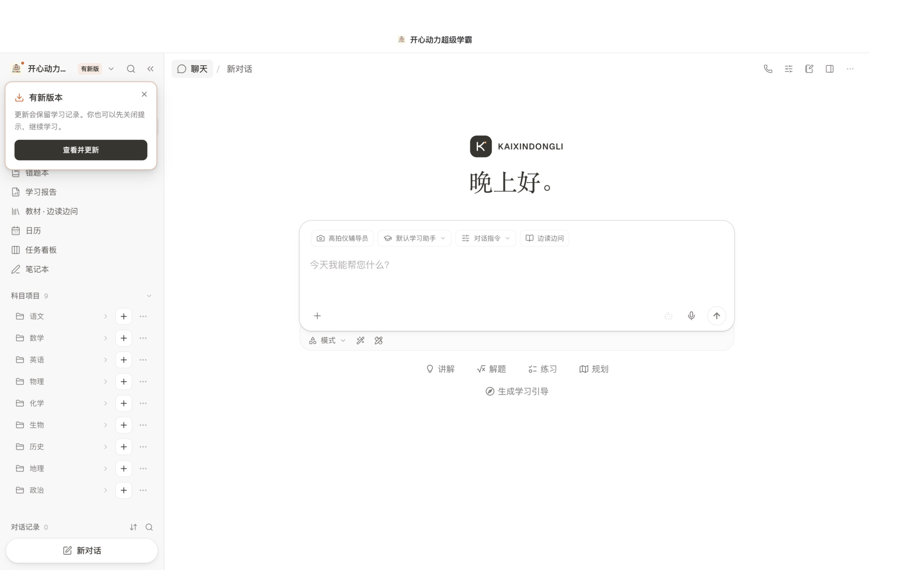

# 有新版，头像旁边会告诉你

打开客户端后会在后台检查 GitHub，之后每四小时再检查一次。只有发现适用于本机、签名有效、运行环境齐备的更新，左上角头像旁才会出现提示卡。

- 点「查看并更新」直接打开已有的更新确认窗口，显示将安装的构建；不用进入设置。
- 点右上角「×」可以先继续学习，头像旁仍保留圆点和「有新版」标记。收起侧栏、切换页面不会反复弹出同一张已关闭的卡。
- 再点头像，菜单第一项仍有「查看并更新」。收起侧栏时，头像也保留标记。
- 后台检查只提示，不会自行下载、安装或停止学习。确认安装后沿用签名校验、数据备份和失败回退。
- 已是当前版本时不显示新版提示；网络故障也不会伪装成新版本。

## 已安装用户

本次头像提示需要启动器与核心界面一起更新。Intel Mac 已安装完整版的用户，先退出客户端，解压[本轮启动器 ZIP](https://github.com/1281504089-cell/kaixin-k12-tutor/releases/download/core-updates/Kaixin-Updater-20261113-avatar-macos-x64.zip)，用里面的应用替换 Applications 中的旧应用，再从「核心 → 检查更新」获取本轮签名核心。以后有新版会在头像旁提醒。不要删除本机学习数据目录。

这不是首次安装包，不包含完整 Python 环境和 136 册教材；首次安装仍使用首页对应系统的完整学生版。本机 Intel Mac 已完成启动器和核心更新，原有学习记录与个人设置核对保留。

## 验证范围

18 项桌面测试、18 项前端测试、生产构建、TypeScript 和桌面脚本语法检查通过。独立客户端用较早的测试构建标识读取真实 GitHub 签名清单，验证提示、确认、取消及头像菜单，不安装预览中的更新。最终关闭状态跨侧栏重挂载的回归测试通过。本机正式更新通过原有备份与校验流程；上传文件不含 API Key、个人学习记录或签名私钥。

三系统源码已同步；本轮只交付 Intel Mac 启动器及代码增量。Apple 芯片、Windows 启动器和三个系统完整安装包未重打，不能把源码同步当作其原生安装验证。开发者执行 `python3 bootstrap_source.py --with-updates` 可按顺序应用本补丁。
