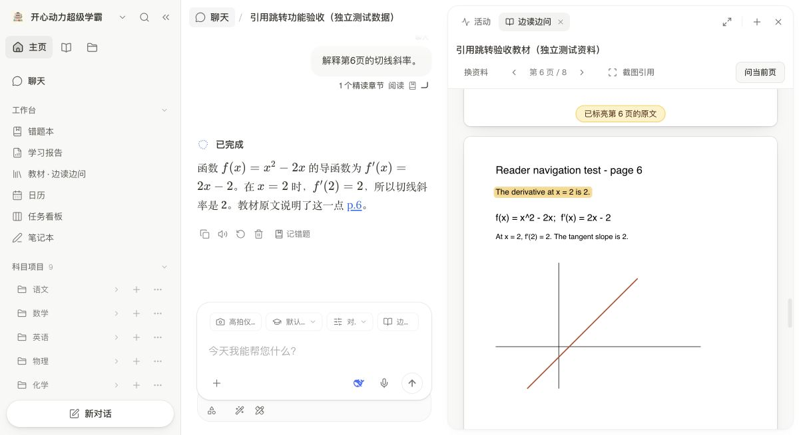
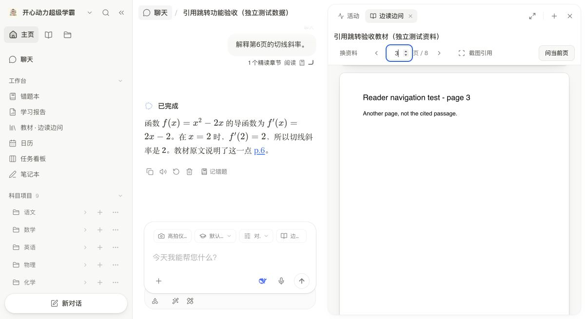

# 20261113 整合更新

这次把 11 月 13 日已完成的桌面优化和原生学习操作分支合到同一份源码，保留 DeepTutor 的问答、流式输出和本机运行方式。

## 对话里的教材引用也能跳原页

在普通聊天里打开「边读边问」后，回答中的 `p.N` 页码可以直接打开相应教材原页；右侧阅读区已收起或正在显示活动时，也会重新打开原资料。找到原句时短暂标亮，只有页码依据时只定位该页，不伪造具体行号。

阅读区上方的页码框可以直接输入数字，按回车跳转。普通对话与工作台使用同一输入逻辑；越界、小数和空值不跳转，按 Esc 取消。输入的是 PDF 文件页码，与教材印刷页码可能有偏移。

引用绑定原资料 ID、版本和有效页码，并检查真实的服务端阅读依据。点击旧资料的引用，不会套用当前打开的另一本教材。选取的原图、公式截图和区域仍沿用原生阅读组件。

上图为真实界面操作截图，内容使用独立测试 PDF 与测试消息，演示“阅读区未打开 → 点击 p.6 → 打开第 6 页 → 原文短暂标亮”。它不是学生学习记录，也不是本轮模型答题质量的证明。

同一独立测试资料的实拍：输入“3”后按回车，原页定位到第 3 页。

## 无关教材不再额外研读一遍

服务端已经按权限读取的少量原页内容直接交给原有回答流程，不再为了同一批页内容多跑一次资料研读模型。普通独立问题与当前教材页无关时，可以直接回答；学生明确引用、选区、原图或跨页追问时保留相应依据。复杂混合资料仍保留原有研读流程。页图准备放到工作线程，不占用服务主事件循环。

另一台电脑截图中的“执行任务的进程丢失”说明工作进程曾失联。当前没有那台电脑的日志，不能据此断言一定由无关教材造成，也不能宣称已经在那台电脑复现并修复。

## 一起合入的功能

- 附件可选临时使用或长期保存；长期附件复用原生资料库。
- 九科项目可以直接新建对话；聊天可移入项目。
- 聊天中查询授权范围内的历史、资料和错题，创建及修改学习任务。任务操作保留读回、权限、重放与确认处理。
- 离线语音输入及录音声波反馈；模型切换时兼容历史空消息，保留原图和工具依据。
- 完整文字选择题补快捷选项，提交后保留原题。
- 讲题需要图时优先静态配图，参数作图复用原 SVG／GeoGebra，动态与视频仍用原有流程。
- DeepSeek 保留 High；按任务设置有限的生成与恢复预算。原生学习操作最多 3 次模型请求、8 次工具操作，单次 8192、整轮 12288 token（含思考），模型等待累计上限 15 秒；这不是所有普通问答的统一上限。

## 验证范围

冻结源码：`70d682c4f455632bc323343e681a7a7b44d2124d`。

- 后端相关回归：208 项通过。
- 前端相关测试：13 个测试文件、85 项通过，无未处理异步错误。
- TypeScript 与正式前端构建通过。
- 补丁应用到上一份公开源码后，48 个变更文件逐字节一致，密钥扫描通过。
- 独立界面实测：关闭阅读区后点击教材页码、重新打开原资料、第 6 页定位与高亮通过；输入“3”并回车，真实 PDF 跳到第 3 页。
- 两次真实 DeepSeek Flash High 路径小测：无关原页问题首个可见输出约 10.0 秒、完成约 16.5 秒；明确公式追问约 9.2 秒、完成约 14.0 秒。均未另跑资料研读模型。这是两次路径与耗时测试，不是速度保证，也不是整套教学答案准确率测评。

全量 Node 静态检查中有 3 项既有失败（原生 title 静态约束、两个旧阅读绑定匹配规则）；涉及的 8 个文件与上一公开基线完全一致。本次相关回归通过，不能写作“全仓全部检查通过”。

## 获取与更新

源码：按 [开发说明](DEVELOPMENT.md) 执行 `bootstrap_source.py --with-updates`，会按顺序应用本次整合补丁。不要只取最后一份补丁覆盖旧版。

本机 Intel Mac 已更新到 `1.7.1-kaixin-20261113-integrated.2-x64`，原有学习记录与设置保留；原生菜单检查更新实测显示“已是最新版本”。签名增量包和两个 Intel 清单经 GitHub 下载回读，内容与本地逐字节一致。

首次完整安装包仍为 20261112 的三系统版本。20261113 更新为签名代码增量包，复用已安装的本机运行环境与教材；不包含共享 API Key 和个人学习记录。系统更新清单只在对应平台通过验证后切换。

验收详情：[verification-integrated-20261113.json](verification-integrated-20261113.json)。本轮没有重新制作三系统完整安装包，也没有在 Apple 芯片 Mac 或 Windows 真机完成本轮试装。
