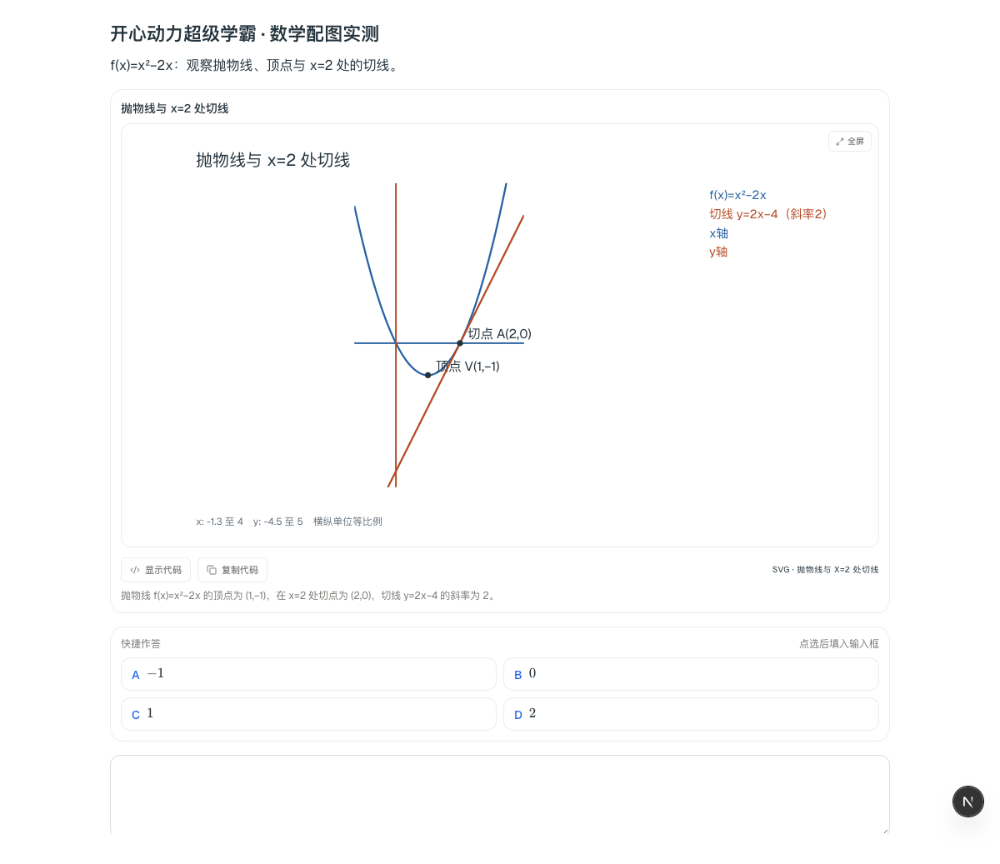
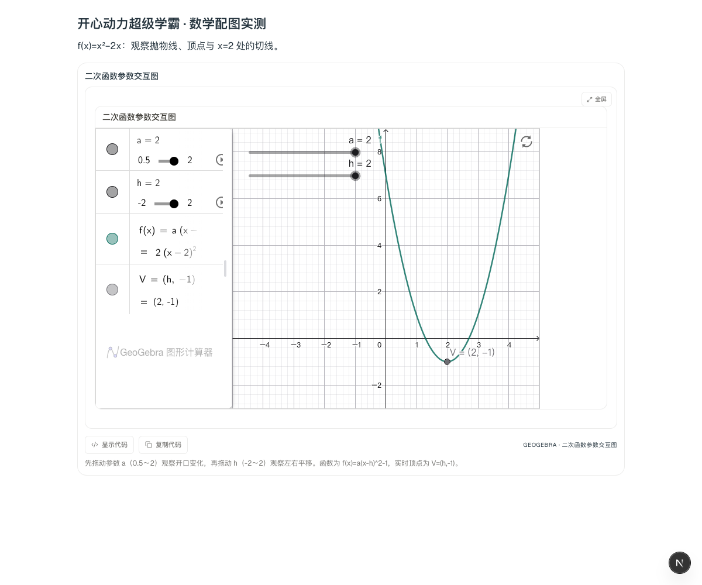

# 数学配图与选择题卡：20261113 源码更新

> 后续交付：本说明中的改动已合入 [20261113 整合更新](INTEGRATED-20261113.md)。Intel Mac 提供签名代码增量包；下文“仅源码／客户端未更新”描述的是本说明初次验收时的状态。三系统完整安装包仍为 20261112，Apple 芯片与 Windows 本轮未做真机试装。

这次补的是日常讲题：需要看图才能讲清楚时，老师主动配一张静态图；需要研究变化，或学生明确要求时，再给交互图。简单计算不为装饰而画图。

**这里只更新源码。GitHub 上的 20261112 安装包、本机已安装的客户端尚未包含本次修改。**

## 保留原流程，只补有实测收益的部分

SVG 的展示、放大、复制和安全处理继续使用 DeepTutor 的原组件；交互图继续使用已经随本机环境交付的 GeoGebra；数学动画与视频讲解继续走原来的 Manim／视频课件流程。没有另建云服务器、添加生图付费服务或引入新的绘图库。

普通函数与坐标题增加了一条小型数据绘图路径：模型提供公式、坐标和短标签，本机计算曲线与位置，不再让模型逐点编写长篇 SVG。交互图同样由小型参数数据构造原生滑块和依赖对象。它解决的是实测中原始流程思考过久、写不出绘图结果的问题。

DeepSeek High 回答中已经给出的完整绘图数据可以直接复用，只另做一次独立核对；不再为同一份数据重复调用生成模型。其他已配置聊天模型仍保留原选择，绘图链路按项目规则使用 High。没有删减老师、原题、资料或必要核对来换速度。已有图片历史保持图片输入，不把图片编码作为一大段正文重复发送。

同一道题、同一个 DeepSeek Flash High，在本机做了如下对照：

| 路径 | 实测结果 | 模型用量 |
| --- | --- | --- |
| 修改前的原始 SVG 可视化流程 | 90 秒内未交付图；第一轮已达到输出预算，仍未写出绘图内容 | 第一轮输出 16,000 tokens，均为思考；超时后的总用量不完整，不能算成零 |
| 补充的静态数据绘图，含独立核对 | 22.3 秒，生成并通过核对 | 2 次调用，4,862 tokens |
| 参数交互图，含独立核对 | 22.5 秒，生成并通过核对 | 2 次调用，5,082 tokens |
| 普通聊天，只问“导数为什么是 2”，没有要求画图 | 11.6 秒开始出字，26.8 秒显示图，35.0 秒完成回答；主动配图并复用回答中的数据 | 全轮 3 次调用；16,911 输入 tokens、5,366 输出 tokens，未触及预算 |

样题为 `f(x)=x²−2x` 在 `x=2` 处的切线，须标出切点 `(2,0)`、顶点 `(1,-1)`，切线应为 `y=2x−4`。这些是单个样题的实测值，不是所有模型、所有题目的速度承诺。

## 学生怎么用

正常提问即可。函数图像、几何位置、坐标或受力示意确有帮助时，老师会主动调用配图；图直接随回答显示，不需要学生再复制代码或手动打开另一个生成工具。

要看变化时，可以说“给 `a`、`h` 加滑块，观察 `a(x-h)²-1` 的变化”。滑块移动后，曲线和顶点由本机重新计算，不追加模型调用。浏览器实测了三组参数：`(0.5,-2)`、`(1,0)`、`(2,2)`；顶点和函数值均正确更新，包含浏览器绘制等待的更新时间约 0.015～0.074 秒。窄栏显示也已检查，无额外横向滚动。

下面是候选源码中实际组件的截图，使用的是上述测试输出；不是设计稿，也不代表旧安装包已经更新。

## 选择题不再只剩一段文字

模型提出需要学生作答的选择题时，优先走原生答题卡。若模型仍写出了完整的 A/B/C/D 文字题，界面会补上快捷选项；点选后填入当前输入框，确认后发送。多选题先选择多项，再点“填入答案”。原题和选项一直保留，公式使用原有数学渲染组件显示。

普通聊天、边读边问、学习对话和笔记侧边对话共用这项处理。原生答题卡不会重复补卡；答案表、代码块、引用块、普通方法列表和选项不完整的文本不会强行当成一道题。

## 速度与失败处理

绘图和独立核对共用本轮 90 秒上限；没有自动重复请求同一道题的生成。达到输出限额、超时、核对不通过或绘图命令失败时，不把残缺图当成完整结果展示，也不让绘图一直转圈。原来的其他对话、阅读资料、老师规则和流式回答机制保持原有流程。

补齐了 GeoGebra 返回值的适配：设置滑块值、位置和标签等操作使用它原有的 API，避免把成功执行的设置误判为失败；真正失败的构造仍会拦截。修正了颜色规则，保留旧的颜色数据兼容。

## 验证和边界

- Python 测试、Web 测试、TypeScript 检查及补丁顺序检查已通过；精确数量、模型用量和浏览器验算数据见[验证记录](verification-math-choices-20261113.json)。
- 图形核对包含原题关系、公式、坐标、参数依赖和取值，静态曲线由本机数值计算；图片依据作为图片传递。核对结论不等同于“已证明所有题目都不会出错”。
- 快速数据路径覆盖常见二维函数、线段、点、圆和参数函数；复杂三维构造、完整连续讲解仍保留原来的 GeoGebra／Manim／视频入口。本次没有重新比较完整视频的生成速度。
- 本次实测环境为 Intel Mac。未重新制作或试装 Windows／Apple 芯片安装包，未修改个人学习记录，也未上传 API Key。

源码恢复方式不变：在发行仓库运行 `python3 bootstrap_source.py --with-updates`，按 `source-manifest.json` 的顺序应用补丁即可。本次补丁接在 `student-uploads-models-stt-20261113.patch` 后面。
