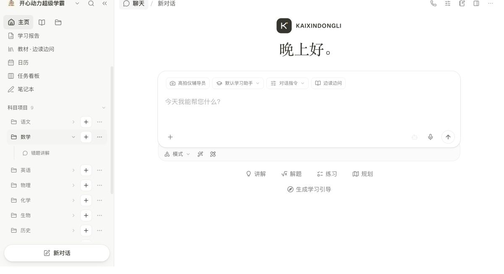

# 科目旁边的「＋」，就是在这科新建对话

现在每个科目右侧都有一个常驻的小「＋」，和项目指令的「…」分开。点数学的「＋」就在数学里建普通对话，自动选数学老师；点英语的就在英语里建。新建期间按钮会暂时停用，避免连续点击建出重复对话。

九科默认只保留一个「错题讲解」。原来的「预习／复习」默认入口不再显示、不再创建；**旧聊天和内容没有删除**。已有错题对话沿用原来的 `-2` 身份，老师、对话指令和项目指令保留。手动新建的普通对话也保留。

## 验证与版本

- 真实页面中观察到九科各有新建按钮；实点数学「＋」后，进入数学项目的新对话，显示数学老师。刷新后仍属于数学项目。截图和操作使用独立测试数据。
- 58 项后端测试通过，包括旧版数据、删过默认对话、老师归属和报告记录读取；12 项前端测试通过，包括双击、失败反馈、项目指令和头像。生产构建及 TypeScript 检查通过。
- 本机已通过客户端的签名校验、备份与更新流程安装，运行源码 `5aad706a5d3d70b5b422150a26a8646fa117a6e4`，前端构建 `3PPWTumZaWJf5NvukjsIK`。九科默认错题入口、前后端健康检查和构建一致性均通过。
- 原有 31 个对话、106 条消息保留；API 与个人设置保持不变。默认对话初始化记录按新规则更新。
- 其他已有功能沿用同一份整合源码，包含此前的阅读引用／页码跳转、附件、语音输入、选择卡、数学配图及搜索修复；本次未修改模型回答或流式生成代码。

## 获取

Intel Mac 已安装用户：在客户端「核心 → 检查更新」获取 `1.7.1-kaixin-20261113-projects-x64` 签名增量。复用已有教材和运行环境，保留学习工作区。

开发者：拉取后执行 `python3 bootstrap_source.py --with-updates`。`source-manifest.json` 已在搜索修复之后追加本补丁；在干净父版本应用后，7 个文件逐字节一致。

**三个系统的完整安装包本轮未重打。Apple 芯片和 Windows 的客户端更新清单也未改成本轮版本，不能把源码同步理解成这两套安装包已更新。** 保留原生验证范围；不上传 API Key、学习记录或签名私钥。
